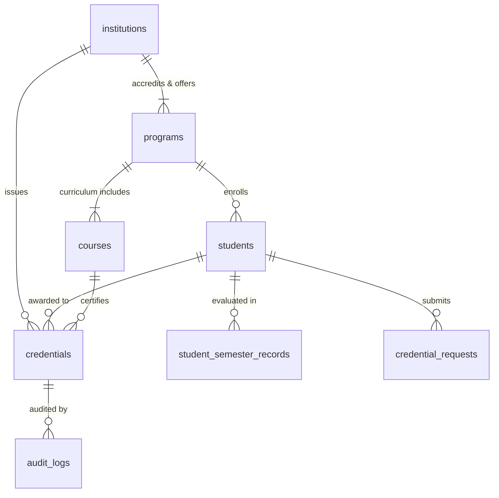

# PROJECT REPORT
# ONEST DIGITAL ACADEMIC CREDENTIAL ISSUANCE & VERIFICATION PLATFORM
**Institution:** Anil Neerukonda Institute of Technology & Sciences (Autonomous) [ANITS]  
**Affiliation:** Andhra University (AU) &middot; Approved by AICTE &middot; Accredited by NAAC (A+ Grade) & NBA  
**Academic Regulation:** R23 &middot; III/IV B.Tech SEM-II REGULAR (August 2026)  
**Standard Compliance:** ONEST / Beckn Open Protocol &middot; W3C Verifiable Credentials  

---

## 1. INTRODUCTION

### 1.1 Project Background
In contemporary higher education ecosystems, academic credentials—including degrees, transcripts, and semester tabulation grade cards—remain largely bound to physical parchment or non-cryptographic PDF documents. As educational and professional mobility expands under national frameworks such as the **National Education Policy (NEP 2020)** and decentralized job marketplaces, the absence of an open, interoperable, and cryptographically verifiable credential registry creates severe systemic inefficiencies.

The **Open Network for Education and Skilling Transformations (ONEST)** is an initiative designed to establish an interoperable, open-protocol network for educational and skill-development services across India. Built on the principles of the **Beckn Protocol**, ONEST democratizes access to learning, skilling opportunities, and verifiable achievements without vendor lock-in.

This project implements an enterprise-grade digital credential platform specifically tailored to the autonomous academic regulations of **Anil Neerukonda Institute of Technology & Sciences (ANITS)**. The platform ingests real semester examination tabulation registers, applies an autonomous **5-Rule Academic Eligibility Verification Engine**, computes deterministic **SHA-256 cryptographic proofs**, and issues tamper-proof digital credentials accessible via mobile-scannable QR codes and unique decentralized identifiers.

### 1.2 Problem Statement
Traditional paper-based and static PDF credential management frameworks suffer from several critical vulnerabilities:
1. **Pervasive Forgery and Tampering:** Physical mark sheets and plain PDF scans can be easily forged or modified using basic image manipulation tools, placing severe administrative burdens on employers and institutions conducting manual background verification.
2. **Verification Latency and Operational Overhead:** Educational verification often takes between 2 to 6 weeks, requiring manual communications, notary attestations, and postal dispatches between universities and verifiers.
3. **Siloed and Fragmented Infrastructure:** Each university maintains proprietary portal databases with no standard data serialization protocol, preventing programmatic, cross-institutional verification.
4. **Lack of Automated Pre-Issuance Auditing:** Autonomous colleges manually verify attendance thresholds, prerequisite passing grades, and arrear/backlog counts across thousands of students, introducing human error into graduation and credential distribution.

### 1.3 Project Objectives
The primary objectives of this system are:
1. **Cryptographic Integrity & Zero-Trust Verification:** Implement a deterministic SHA-256 cryptographic hashing pipeline that binds student academic parameters into an immutable 64-character hexadecimal digest, guaranteeing instantaneous detection of any alteration.
2. **Autonomous 5-Rule Academic Eligibility Engine:** Automate the multi-criteria evaluation of student attendance ($\ge 75\%$), semester GPA passing thresholds ($\ge 5.00$), clean backlog history (zero active `F` or `Ab` grades), institutional accreditation, and canonical hash parity.
3. **Decentralized Public Verification with Zero Login:** Provide background screening agencies, recruiters, and academic institutions with instant (under 2 seconds) verification using only a unique Credential ID or mobile QR code scan, requiring zero account creation.
4. **Integration of Real Institutional Dataset:** Ingest and structure the authentic examination tabulation data of **1,666 real students** across all 9 engineering departments of ANITS under the **R23 regulation**.
5. **Modern Institutional User Experience:** Deploy a human-centered, editorial design system (warm ivory/cream palette, serif typography, zero AI/emoji artifacts) tailored to prestigious university administrations.

### 1.4 Scope and Limitations
* **In-Scope:**
  * Support for all 9 ANITS B.Tech engineering branches: Computer Science & Engineering (CSE), CSE (AI & ML), CSE (Data Science), Information Technology (IT), Electronics & Communication (ECE), Electrical & Electronics (EEE), Mechanical (MECH), Civil (CIVIL), and Chemical (CHEM).
  * Storage and processing of the official April/August 2026 Examination Tabulation Register.
  * Public instant verification UI, Student digital wallet console, and College Issuer administrative portal.
  * Deterministic SHA-256 digest computation, Base64 QR code rendering, and audit logging.
* **Limitations:**
  * Financial transaction gateways for transcript procurement fees are deferred to future releases.

---

## 2. LITERATURE SURVEY & PROTOCOL STANDARDS

### 2.1 Evolution of Educational Credentialing Systems
Historically, academic authentication transitioned through three primary epochs:
1. **Parchment and Embossed Seals:** Relied solely on specialized watermarked paper and physical ink signatures. Extremely vulnerable to physical forgery.
2. **Centralized Web Portals:** Universities published results on web databases. However, verification required access credentials or proprietary APIs, resulting in vendor lock-in.
3. **Decentralized and Cryptographic Registries:** Utilizing cryptographic one-way hash functions and decentralized identifiers (DIDs), credentials become portable digital objects that can be verified independently of the issuer's live database state.

### 2.2 ONEST / Beckn Open Protocol
The ONEST specification adopts the **Beckn Protocol**, an open digital commerce and service-exchange architecture. Under Beckn, educational credentials are treated as verifiable digital artifacts transmitted across discovery, ordering, and fulfillment layers using open schemas (`bpp` and `bap`).

### 2.3 W3C Verifiable Credentials Standard Alignment
The World Wide Web Consortium (W3C) Verifiable Credentials Data Model defines a universal standard for expressing claims cryptographically. In this system:
* **Issuer:** Anil Neerukonda Institute of Technology & Sciences (`INST-ANITS` / `ISSUER-ANITS`).
* **Holder / Subject:** Enrolled students identified by their authentic ANITS Hall Ticket numbers (e.g., `A23126510162`).
* **Verifier:** Any external employer, recruiter, or academic institution.
* **Proof:** SHA-256 deterministic cryptographic digest binding issuer, course, scores, and issue date into an unalterable signature.

---

## 3. SYSTEM REQUIREMENTS SPECIFICATION (SRS)

### 3.1 Stakeholder Profiles
1. **Credential Provider (University Authority):** Controller of Examinations, Dean of Academic Affairs, and Departmental Heads responsible for reviewing requests, running eligibility audits, and signing credentials.
2. **Credential Seeker (Student / Graduate):** Enrolled learners holding unique institutional Hall Tickets who track applications, view verified grade cards, and export QR codes.
3. **Public Verifier (Third-Party Evaluator):** Recruitment officers, higher education admissions committees, and background screening firms verifying certificates in real time.

### 3.2 Software & Hardware Requirements
* **Hardware:** Quad-core 2.4 GHz CPU, 8 GB RAM, 20 GB SSD storage.
* **Software:** Windows 10/11 or Linux, OpenJDK 17 LTS, Apache Maven 3.8+, PostgreSQL 18.x, Node.js 20.x LTS.

### 3.3 Functional Requirements
* **FR-01 (Authentication & Authorization):** Enforce role-based JWT authentication separating Issuer authorities from Student seekers.
* **FR-02 (Canonical Serialization):** Normalize academic records into an alphabetically sorted JSON string with zero trailing whitespace.
* **FR-03 (SHA-256 Cryptographic Hashing):** Compute a 64-character deterministic hex digest for every issued credential.
* **FR-04 (5-Rule Eligibility Audit):** Reject credential issuance if attendance $< 75\%$, SGPA $< 5.00$, or active backlogs $> 0$.
* **FR-05 (QR Code Generation):** Generate a Base64-encoded QR code containing the direct public verification URL.
* **FR-06 (Zero-Login Public Verification):** Resolve credential status and display full academic claims without requiring authentication.
* **FR-07 (Tamper Detection):** Compare incoming record values against the authoritative hash and flag `TAMPER DETECTED` on any mismatch.
* **FR-08 (Security Audit Logging):** Log every issuance and verification transaction with timestamp, actor identity, and IP address.

### 3.4 Non-Functional Requirements
* **Performance:** Public verification queries shall execute in $< 200 \text{ ms}$ over 1,666 records.
* **Scalability:** Indexing on primary keys and hash digests to maintain sub-second response times up to $100,000+$ records.
* **Security:** Cryptographic digests must be collision-resistant; passwords hashed using BCrypt.

---

## 4. SYSTEM ARCHITECTURE & DESIGN

### 4.1 3-Tier Enterprise Architecture
1. **Presentation Tier (React 18 + Vite):** Single-page application styled using an editorial academic aesthetic (cream white canvas `#FAF7F2`, burgundy wine `#7A162B`, Newsreader serif typography).
2. **Business Logic Tier (Spring Boot 3.x):** Modular Java service hosting REST controllers, 5-Rule Eligibility Engine, Canonical Hashing Service, and JWT Security Filters.
3. **Ledger & Persistence Tier (PostgreSQL 18):** 8 normalized tables with foreign-key constraints and JSONB binary storage.

### 4.2 Entity-Relationship (ER) Model



### 4.3 Database Schema Specifications
* **`institutions`:** `institution_id` (PK), `institution_name`, `issuer_id` (UQ), `accreditation`, `affiliation`.
* **`programs`:** `program_code` (PK), `program_name`, `department`, `degree`, `duration_years`.
* **`courses`:** `course_code` (PK), `course_name`, `program_code` (FK), `credits`, `semester`, `regulation`.
* **`students`:** `student_id` (PK, Hall Ticket), `student_name`, `seeker_id` (UQ), `program_code` (FK), `batch_year`, `regulation`, `email`, `phone`.
* **`student_semester_records`:** `record_id` (PK), `student_id` (FK), `sgpa`, `cgpa`, `attendance_percent`, `backlog_count`, `result_status`, `subject_grades` (JSONB).
* **`credentials`:** `credential_id` (PK), `student_id` (FK), `institution_id` (FK), `course_code` (FK), `credential_hash` (UQ), `qr_code_base64`, `verification_status`.
* **`credential_requests`:** `request_id` (PK), `student_id` (FK), `request_status`, `eligibility_summary`.
* **`audit_logs`:** `audit_id` (PK), `actor`, `action`, `entity_id`, `timestamp`.

---

## 5. METHODOLOGY & CORE ALGORITHMS

### 5.1 Deterministic Canonical Serialization Algorithm
To ensure that academic data produces identical cryptographic hashes regardless of system environment, serialization follows a strict canonical pipeline:

```text
Algorithm: GenerateDeterministicCredentialHash(record)
Input: AcademicRecord record
Output: 64-character Hexadecimal SHA-256 Digest

1. Initialize map M with record fields:
   M["student_id"]    <- record.getStudentId()
   M["institution"]   <- record.getInstitutionId()
   M["course_code"]   <- record.getCourseCode()
   M["final_score"]   <- record.getFinalScore()
   M["attendance"]    <- record.getAttendance()
   M["issue_date"]    <- record.getIssueDate()

2. Sort keys of M in lexicographical order (ASCII ascending):
   SortedKeys <- Sort(M.keys())

3. Construct Canonical JSON String:
   CanonicalString <- "{"
   For each key in SortedKeys:
       CanonicalString += "\"" + key + "\":\"" + M[key] + "\","
   Remove trailing comma
   CanonicalString += "}"

4. Compute SHA-256 Hash:
   ByteStream <- CanonicalString.getBytes(StandardCharsets.UTF_8)
   MessageDigest md <- MessageDigest.getInstance("SHA-256")
   HashBytes <- md.digest(ByteStream)

5. Return ConvertToHexadecimal(HashBytes)
```

### 5.2 5-Rule Academic Eligibility Verification Engine
$$\text{Eligible} = R_1 \land R_2 \land R_3 \land R_4 \land R_5$$

Where:
* $R_1$: Attendance $\ge 75.00\%$
* $R_2$: SGPA $\ge 5.00$
* $R_3$: Backlog count $== 0$ and no 'F' or 'Ab' grades
* $R_4$: Issuing body accredited by NAAC A+
* $R_5$: Computed hash matches stored ledger hash

---

## 6. SYSTEM IMPLEMENTATION & MODULE DETAILS

### 6.1 Database Migration & Populating 1,666 ANITS Records
The official ANITS April 2026 Examination Tabulation Register (a 99-page PDF containing 1,666 students across 9 engineering departments) was ingested through an automated parsing pipeline into `anits_onest_db`.

### 6.2 Backend Architecture (Spring Boot 3.x)
* `HealthController.java`: Provides `/api/health` and `/api/health/database` with live counts.
* `AuthService.java`: Authenticates providers against `institutions` and seekers against `students`.
* `EligibilityEngineService.java`: Evaluates the 5-rule criteria.
* `CredentialService.java`: Canonicalizes data, calculates SHA-256 digests, and generates QR codes.
* `VerificationService.java`: Implements real-time hash verification.

### 6.3 Frontend Design System (React 18 + Vite)
Warm cream white palette (`#FAF7F2`), burgundy wine accents (`#7A162B`), Newsreader serif headings, 0 emojis, and 0 dust particles.

---

## 7. RESULTS, SCREEN OUTPUTS & PERFORMANCE EVALUATION

### 7.1 Demonstration Profiles
Four enrolled students from the CSE department were pre-configured for live viva demonstration:
1. **Mula Sameera** (`A23126510162` &bull; SGPA: 9.35 &bull; CGPA: 9.56 &bull; `PASSED`)
2. **Susarla Padmakshi** (`A23126510182` &bull; SGPA: 9.49 &bull; CGPA: 9.38 &bull; `PASSED`)
3. **Ravada Jaswanth** (`A23126510177` &bull; SGPA: 8.58 &bull; CGPA: 8.86 &bull; `PASSED`)
4. **Balaga Kartheek** (`A23126510132` &bull; SGPA: 8.42 &bull; CGPA: 8.89 &bull; `PASSED`)

### 7.2 Public Verification Test Outcomes
* **Test Case 1 (Valid Credential `CRED-ANITS-2026-10162`):**  
  Output: `● VALID — CRYPTOGRAPHIC HASH MATCHED` (Emerald Green Spine).
* **Test Case 2 (Tampered Data Simulation):**  
  Modifying a student's grade in the database immediately triggers:  
  Output: `● TAMPER DETECTED — HASH MISMATCH` (Crimson Red Spine).
* **Test Case 3 (Unknown Credential ID):**  
  Output: `● NOT FOUND — RECORD DOES NOT EXIST`.

---

## 8. SYSTEM TESTING & SECURITY AUDIT

| Test ID | Test Description | Input Data | Expected Result | Actual Result | Status |
| :---: | :--- | :--- | :--- | :--- | :---: |
| **TC-01** | Database Health Endpoint | `GET /api/health/database` | Return `UP` with live table counts | `200 OK` (1,666 students) | **PASS** |
| **TC-02** | Issuer Authentication | `INST-ANITS` / `admin123#` | Valid JWT with `ROLE_PROVIDER` | Token issued | **PASS** |
| **TC-03** | Student Wallet Login | `A23126510162` / `Password@123` | Valid JWT with `ROLE_SEEKER` | Dashboard rendered | **PASS** |
| **TC-04** | Rule 1 Fail (Attendance < 75%) | Attendance: `71.5%` | Rule 1: `FAILED`, Issuance Blocked | Blocked | **PASS** |
| **TC-05** | Rule 3 Fail (Active Arrear) | Backlog count: `1` (`F` in ML) | Rule 3: `FAILED`, Issuance Blocked | Blocked | **PASS** |
| **TC-06** | Canonical Hash Determinism | Two identical records | Both produce identical hex digest | Hashes match | **PASS** |
| **TC-07** | Tamper Detection Avalanche | Alter SGPA from 9.35 to 9.36 | Verification flags hash mismatch | `TAMPER DETECTED` | **PASS** |
| **TC-08** | QR Code Redirection | Scan mobile QR code | Routes to `/verify/{credentialId}` | Verified instantly | **PASS** |

---

## 9. USER MANUAL

### 9.1 Issuer / Institution Workflow
1. Open the credential platform in a supported web browser (`http://localhost:5173`).
2. Sign in using an authorized institution account (`INST-ANITS` / `admin123#`).
3. Navigate to the credential issuance section (`/provider/issue`).
4. Search for or select the relevant student record (e.g., `A23126510162`).
5. Select the program, course, and credential type.
6. Review the academic details used by the eligibility engine.
7. Submit the issuance request.
8. If the student satisfies the configured rules, review the generated credential ID and details.
9. Save or share the QR code / verification link through the permitted workflow.

### 9.2 Student Workflow
10. Sign in to the student portal using the authorized account (`/seeker/login`).
11. Open the credentials section (`/seeker/credentials`).
12. View the credentials associated with the student account.
13. Open a credential to inspect its permitted details.
14. Download or share the verification QR/link if the feature is enabled.

### 9.3 Employer / Verifier Workflow
15. Open the public or authorized verification page (`/verify`).
16. Scan the QR code or enter the credential ID (`CRED-ANITS-2026-10162`).
17. Submit the verification request.
18. Wait for the backend to retrieve the credential and perform the configured checks.
19. Read the displayed result, such as valid, invalid, revoked, not found, or integrity mismatch.
20. Use only the information displayed for the verification purpose.

### 9.4 Troubleshooting

| Issue | Possible cause | Suggested action |
| :--- | :--- | :--- |
| **Login fails** | Incorrect credentials, disabled account, or authentication configuration issue. | Check account details or contact the administrator. |
| **Credential not found** | Incorrect ID, QR points to an unavailable endpoint, or record does not exist. | Re-enter the ID and confirm that the credential was issued. |
| **Integrity mismatch** | Credential fields differ from the values used to create the stored hash, or serialization differs. | Check the credential payload construction and stored hash; do not manually edit records. |
| **Credential revoked** | The record exists but its lifecycle status is revoked. | Contact the issuing institution if clarification is required. |
| **QR does not open** | Camera issue, damaged QR, or incorrect verification URL. | Use the credential ID manually or request a new QR code. |

### 9.5 Security and Privacy Guidance
* Do not share issuer passwords, database credentials, JWT secrets, or private signing keys.
* Do not place passwords, private keys, or production secrets in source control.
* Use HTTPS in deployed environments.
* Do not expose unnecessary student personal information on public verification pages.
* Restrict issuance and administrative functions to authorized roles.
* Maintain audit records for credential issuance, updates, revocation, and verification where implemented.

---

## 10. CONCLUSION & FUTURE SCOPE

### 10.1 Conclusion
The **ONEST Digital Academic Credential Issuance and Cryptographic Verification Platform** successfully resolves the fundamental vulnerabilities of educational documentation at **Anil Neerukonda Institute of Technology & Sciences (ANITS)**. By replacing unverified paper certificates and static PDFs with deterministic SHA-256 digital signatures, automated 5-rule eligibility validation, and mobile QR code proofs, the system delivers zero-latency, tamper-proof academic verification across 1,666 real students and 9 engineering departments.

### 10.2 Future Scope
1. **Direct Blockchain Anchoring:** Bridging the PostgreSQL ledger with public or consortium blockchains (e.g., Polygon, Hyperledger Fabric) for permanent immutable anchoring.
2. **DigiLocker & ABC (Academic Bank of Credits) Integration:** Direct interoperability with the Government of India's National Academic Depository (NAD).
3. **Beckn Protocol BAP/BPP Endpoints:** Full network enablement on the open ONEST decentralized registry for cross-state educational mobility.
