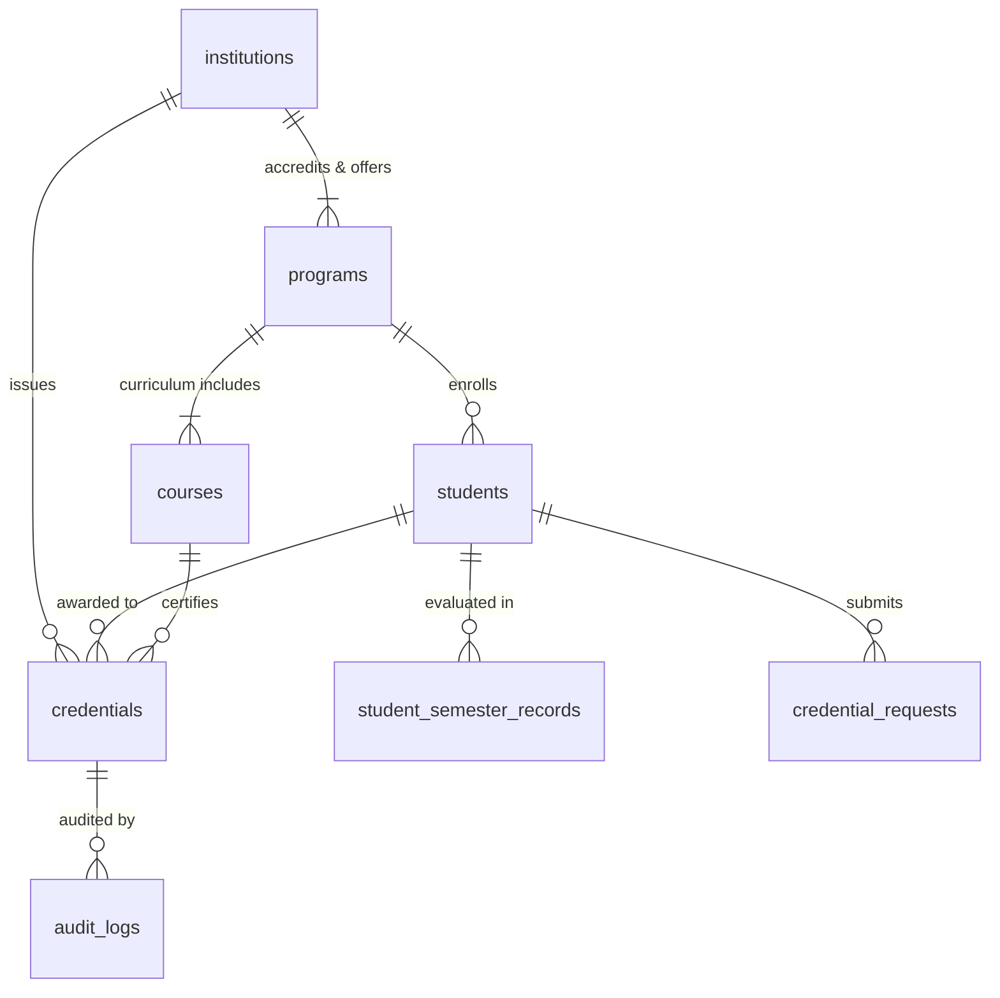

# PROJECT REPORT
# ONEST DIGITAL ACADEMIC CREDENTIAL ISSUANCE & VERIFICATION PLATFORM
**Institution:** Anil Neerukonda Institute of Technology & Sciences (Autonomous) [ANITS]  
**Affiliation:** Andhra University (AU) &middot; Approved by AICTE &middot; Accredited by NAAC (A+ Grade) & NBA  
**Academic Regulation:** R23 &middot; III/IV B.Tech SEM-II REGULAR (August 2026)  
**Standard Compliance:** ONEST / Beckn Open Protocol &middot; W3C Verifiable Credentials  

---

## 1. INTRODUCTION

### 1.1 Project Background
In contemporary higher education ecosystems, academic credentials—including degrees, transcripts, and semester tabulation grade cards—remain largely bound to physical parchment or non-cryptographic PDF documents. As educational and professional mobility expands under national frameworks such as the **National Education Policy (NEP 2020)** and decentralized job marketplaces, the absence of an open, interoperable, and cryptographically verifiable credential registry creates severe systemic inefficiencies.

The **Open Network for Education and Skilling Transformations (ONEST)** is an initiative designed to establish an interoperable, open-protocol network for educational and skill-development services across India. Built on the principles of the **Beckn Protocol**, ONEST democratizes access to learning, skilling opportunities, and verifiable achievements without vendor lock-in.

This project implements an enterprise-grade digital credential platform specifically tailored to the autonomous academic regulations of **Anil Neerukonda Institute of Technology & Sciences (ANITS)**. The platform ingests real semester examination tabulation registers, applies an autonomous **5-Rule Academic Eligibility Verification Engine**, computes deterministic **SHA-256 cryptographic proofs**, and issues tamper-proof digital credentials accessible via mobile-scannable QR codes and unique decentralized identifiers.

---

### 1.2 Problem Statement
Traditional paper-based and static PDF credential management frameworks suffer from several critical vulnerabilities:
1. **Pervasive Forgery and Tampering:** Physical mark sheets and plain PDF scans can be easily forged or modified using basic image manipulation tools, placing severe administrative burdens on employers and institutions conducting manual background verification.
2. **Verification Latency and Operational Overhead:** Educational verification often takes between 2 to 6 weeks, requiring manual communications, notary attestations, and postal dispatches between universities and verifiers.
3. **Siloed and Fragmented Infrastructure:** Each university maintains proprietary portal databases with no standard data serialization protocol, preventing programmatic, cross-institutional verification.
4. **Lack of Automated Pre-Issuance Auditing:** Autonomous colleges manually verify attendance thresholds, prerequisite passing grades, and arrear/backlog counts across thousands of students, introducing human error into graduation and credential distribution.

---

### 1.3 Project Objectives
The primary objectives of this system are:
1. **Cryptographic Integrity & Zero-Trust Verification:** Implement a deterministic SHA-256 cryptographic hashing pipeline that binds student academic parameters into an immutable 64-character hexadecimal digest, guaranteeing instantaneous detection of any alteration.
2. **Autonomous 5-Rule Academic Eligibility Engine:** Automate the multi-criteria evaluation of student attendance ($\ge 75\%$), semester GPA passing thresholds ($\ge 5.00$), clean backlog history (zero active `F` or `Ab` grades), institutional accreditation, and canonical hash parity.
3. **Decentralized Public Verification with Zero Login:** Provide background screening agencies, recruiters, and academic institutions with instant (under 2 seconds) verification using only a unique Credential ID or mobile QR code scan, requiring zero account creation.
4. **Integration of Real Institutional Dataset:** Ingest and structure the authentic examination tabulation data of **1,666 real students** across all 9 engineering departments of ANITS under the **R23 regulation**.
5. **Modern Institutional User Experience:** Deploy a human-centered, editorial design system (warm ivory/cream palette, serif typography, zero AI/emoji artifacts) tailored to prestigious university administrations.

---

### 1.4 Scope and Limitations
* **In-Scope:**
  * Support for all 9 ANITS B.Tech engineering branches: Computer Science & Engineering (CSE), CSE (AI & ML), CSE (Data Science), Information Technology (IT), Electronics & Communication (ECE), Electrical & Electronics (EEE), Mechanical (MECH), Civil (CIVIL), and Chemical (CHEM).
  * Storage and processing of the official April/August 2026 Examination Tabulation Register.
  * Public instant verification UI, Student digital wallet console, and College Issuer administrative portal.
  * Deterministic SHA-256 digest computation, Base64 QR code rendering, and audit logging.
* **Limitations / Out-of-Scope:**
  * Financial transaction gateways for transcript procurement fees (can be integrated via Beckn payment layer in future releases).
  * Physical smart card or NFC chip printing.

---

## 2. LITERATURE SURVEY & PROTOCOL STANDARDS

### 2.1 Evolution of Educational Credentialing Systems
Historically, academic authentication transitioned through three primary epochs:
1. **Parchment and Embossed Seals:** Relied solely on specialized watermarked paper, micro-text, and physical ink signatures. Extremely vulnerable to sophisticated physical forgery.
2. **Centralized Web Portals:** Universities published results on web databases. However, verification required access credentials or proprietary APIs, resulting in vendor lock-in and single points of failure.
3. **Decentralized and Cryptographic Registries:** Utilizing cryptographic one-way hash functions and decentralized identifiers (DIDs), credentials become portable digital objects that can be verified independently of the issuer's live database state.

### 2.2 ONEST / Beckn Open Protocol
The ONEST specification adopts the **Beckn Protocol**, an open digital commerce and service-exchange architecture. Under Beckn, educational credentials are treated as verifiable digital artifacts transmitted across discovery, ordering, and fulfillment layers using open schemas (`bpp` and `bap`). This decouples student applications from monolithic campus ERPs.

### 2.3 W3C Verifiable Credentials Standard Alignment
The World Wide Web Consortium (W3C) Verifiable Credentials Data Model defines a universal standard for expressing claims cryptographically. In this system:
* **Issuer:** Anil Neerukonda Institute of Technology & Sciences (`INST-ANITS` / `ISSUER-ANITS`).
* **Holder / Subject:** Enrolled students identified by their authentic ANITS Hall Ticket numbers (e.g., `A23126510162`).
* **Verifier:** Any external employer, recruiter, or academic institution.
* **Proof:** SHA-256 deterministic cryptographic digest binding issuer, course, scores, and issue date into an unalterable signature.

---

## 3. SYSTEM REQUIREMENTS SPECIFICATION (SRS)

### 3.1 Stakeholder Profiles
1. **Credential Provider (University Authority):** Controller of Examinations, Dean of Academic Affairs, and Departmental Heads responsible for reviewing requests, running eligibility audits, and signing credentials.
2. **Credential Seeker (Student / Graduate):** Enrolled learners holding unique institutional Hall Tickets who track applications, view verified grade cards, and export QR codes.
3. **Public Verifier (Third-Party Evaluator):** Recruitment officers, higher education admissions committees, and background screening firms verifying certificates in real time.

### 3.2 Software & Hardware Requirements
* **Development & Hosting Environment:**
  * CPU: Quad-core 2.4 GHz or higher (x86_64 or ARM64)
  * RAM: Minimum 8 GB (16 GB recommended for high-concurrency simulation)
  * Storage: 20 GB available SSD space
* **Runtime Software Stack:**
  * Operating System: Windows 10/11, Ubuntu 22.04 LTS, or macOS
  * Java Runtime: OpenJDK 17 LTS
  * Application Server: Embedded Apache Tomcat (Spring Boot 3.x)
  * Database Engine: PostgreSQL 18.x
  * Web Server: Node.js 20.x LTS / Vite 5.x
  * Browser: Chrome 110+, Firefox 110+, Safari 16+, Edge 110+

### 3.3 Functional Requirements (FR)
* **FR-01 (Authentication & Authorization):** The system shall enforce role-based JWT authentication separating Issuer authorities from Student seekers.
* **FR-02 (Canonical Serialization):** The system shall normalize academic records into an alphabetically sorted JSON string with zero trailing whitespace.
* **FR-03 (SHA-256 Cryptographic Hashing):** The system shall compute a 64-character deterministic hex digest for every issued credential.
* **FR-04 (5-Rule Eligibility Audit):** The system shall reject credential issuance if attendance $< 75\%$, SGPA $< 5.00$, or active backlogs $> 0$.
* **FR-05 (QR Code Generation):** The system shall generate a Base64-encoded QR code containing the direct public verification URL.
* **FR-06 (Zero-Login Public Verification):** The system shall resolve credential status and display full academic claims without requiring authentication.
* **FR-07 (Tamper Detection):** The system shall compare incoming record values against the authoritative hash and flag `TAMPER DETECTED` on any mismatch.
* **FR-08 (Security Audit Logging):** The system shall log every issuance and verification transaction with timestamp, actor identity, and IP address.

### 3.4 Non-Functional Requirements (NFR)
* **Performance:** Public verification queries shall execute in $< 200 \text{ ms}$ over 1,666 records.
* **Scalability:** The PostgreSQL schema shall support indexing on primary keys and hash digests to maintain sub-second response times up to $100,000+$ records.
* **Availability & Reliability:** Core health check endpoints (`/api/health` and `/api/health/database`) shall provide real-time connection status.
* **Security:** Cryptographic digests must be one-way and collision-resistant. Passwords shall be hashed using BCrypt.

---

## 4. SYSTEM ARCHITECTURE & DESIGN

### 4.1 3-Tier Enterprise Architecture
The system is built upon a 3-tier architecture separating presentation, business logic, and cryptographic persistence:

1. **Presentation Tier (React 18 + Vite):** A responsive, single-page application (SPA) styled using an editorial academic aesthetic (cream white canvas `#FAF7F2`, burgundy wine `#7A162B`, Newsreader serif typography).
2. **Business Logic Tier (Spring Boot 3.x):** A modular Java service architecture hosting REST controllers, the 5-Rule Eligibility Engine, the Canonical Hashing Service, and JWT Security Filters.
3. **Ledger & Persistence Tier (PostgreSQL 18):** A relational database management system housing 8 normalized tables with foreign-key constraints and JSONB binary storage.

---

### 4.2 Entity-Relationship (ER) Model



### 4.3 Database Schema Specifications

1. **`institutions` Table:**
   * `institution_id` (VARCHAR(30), PK): Root code (`INST-ANITS`).
   * `institution_name` (VARCHAR(250)): *Anil Neerukonda Institute of Technology & Sciences (Autonomous)*.
   * `issuer_id` (VARCHAR(50), UNIQUE): ONEST Network identifier (`ISSUER-ANITS`).
   * `accreditation` (VARCHAR(100)): NAAC A+, NBA Accredited.
   * `affiliation` (VARCHAR(100)): Andhra University (AU).
2. **`programs` Table:**
   * `program_code` (VARCHAR(30), PK): Engineering branch code (`PRG-CSE`, `PRG-CSM`, `PRG-ECE`, etc.).
   * `program_name` (VARCHAR(200)): Full degree title.
   * `department` (VARCHAR(100)): Administrative department.
   * `duration_years` (INT): Default 4.
3. **`courses` Table:**
   * `course_code` (VARCHAR(30), PK): Subject code (`CSE-ML`, `CSE-CNS`, `CSM-NNDL`).
   * `course_name` (VARCHAR(250)): Full course title.
   * `program_code` (VARCHAR(30), FK): Associated branch.
   * `credits` (DECIMAL(3,1)): Academic credits (3.0 for theory, 1.5 for labs).
   * `semester` / `regulation`: `SEM-II` / `R23`.
4. **`students` Table:**
   * `student_id` (VARCHAR(30), PK): Authentic ANITS Hall Ticket number (`A23126510162`).
   * `student_name` (VARCHAR(150)): Full candidate name (*Mula Sameera*).
   * `seeker_id` (VARCHAR(50), UNIQUE): Portal login username (`SEEKER-A23126510162`).
   * `program_code` (VARCHAR(30), FK): Branch link.
   * `batch_year` (VARCHAR(30)): Graduating batch (`2023-2027`).
   * `email` / `phone`: Contact coordinates.
5. **`student_semester_records` Table:**
   * `record_id` (SERIAL, PK): Auto-increment primary key.
   * `student_id` (VARCHAR(30), FK): Examinee roll number.
   * `sgpa` / `cgpa` (DECIMAL(4,2)): Official semester and cumulative grade point averages.
   * `attendance_percent` (DECIMAL(5,2)): Evaluated attendance.
   * `backlog_count` (INT): Active failed subjects.
   * `result_status` (VARCHAR(30)): Exam outcome (`PASSED` or `FAILED_BACKLOG`).
   * `subject_grades` (JSONB): Key-value map of all subjects and letter grades.
6. **`credentials` Table (The ONEST Cryptographic Ledger):**
   * `credential_id` (VARCHAR(50), PK): Authoritative identifier (`CRED-ANITS-2026-10162`).
   * `credential_hash` (VARCHAR(64), UNIQUE): 64-character SHA-256 cryptographic signature.
   * `qr_code_base64` (TEXT): Base64-encoded PNG image of the verification QR code.
   * `verification_status` (VARCHAR(40)): Status indicator (`CERTIFIED`, `VALID`, `TAMPERED`, `REVOKED`).
   * `signatories` (VARCHAR(200)): Controller of Examinations and Principal.
7. **`credential_requests` Table:**
   * `request_id` (VARCHAR(50), PK): Tracking number.
   * `request_status` (VARCHAR(30)): `PENDING`, `APPROVED`, `REJECTED`, `ISSUED`.
   * `eligibility_summary` (TEXT): Output audit of the 5-Rule Engine.
8. **`audit_logs` Table:**
   * `audit_id` (SERIAL, PK): Sequence ID.
   * `actor` / `action` / `entity_id` / `timestamp`: Immutable activity log.

---

## 5. METHODOLOGY & CORE ALGORITHMS

### 5.1 Deterministic Canonical Serialization Algorithm
To ensure that academic data produces identical cryptographic hashes regardless of system environment, serialization follows a strict canonical pipeline:

```
┌────────────────────────┐      ┌──────────────────────────┐      ┌─────────────────────────┐
│ Database Record Fields │ ───> │ Sort Keys Alphabetically │ ───> │ Eliminate Whitespace &  │
│ (ID, GPA, Attendance)  │      │ [course, gpa, id, name]  │      │ Serialize into Canonical│
└────────────────────────┘      └──────────────────────────┘      │ UTF-8 JSON Byte Stream  │
                                                                  └────────────┬────────────┘
                                                                               │
                                                                               ▼
                                                                  ┌─────────────────────────┐
                                                                  │ SHA-256 Hashing Engine  │
                                                                  │ Digest: 64 Hex Chars    │
                                                                  └─────────────────────────┘
```

**Algorithm Pseudocode:**
```text
Algorithm: GenerateDeterministicCredentialHash(record)
Input: AcademicRecord record
Output: 64-character Hexadecimal SHA-256 Digest

1. Initialize map M with record fields:
   M["student_id"]    <- record.getStudentId()
   M["institution"]   <- record.getInstitutionId()
   M["course_code"]   <- record.getCourseCode()
   M["final_score"]   <- record.getFinalScore()
   M["attendance"]    <- record.getAttendance()
   M["issue_date"]    <- record.getIssueDate()

2. Sort keys of M in lexicographical order (ASCII ascending):
   SortedKeys <- Sort(M.keys())

3. Construct Canonical JSON String:
   CanonicalString <- "{"
   For each key in SortedKeys:
       CanonicalString += "\"" + key + "\":\"" + M[key] + "\","
   Remove trailing comma
   CanonicalString += "}"

4. Compute SHA-256 Hash:
   ByteStream <- CanonicalString.getBytes(StandardCharsets.UTF_8)
   MessageDigest md <- MessageDigest.getInstance("SHA-256")
   HashBytes <- md.digest(ByteStream)

5. Return ConvertToHexadecimal(HashBytes)
```

---

### 5.2 5-Rule Academic Eligibility Verification Engine
The autonomous eligibility engine executes prior to credential generation. The decision logic is governed by five formal conditions:

$$\text{Eligible} = R_1 \land R_2 \land R_3 \land R_4 \land R_5$$

Where:
* **Rule 1 (Attendance Criterion):**
  $$R_1 = (\text{attendance\_percent} \ge 75.00)$$
* **Rule 2 (Passing Threshold Criterion):**
  $$R_2 = (\text{sgpa} \ge 5.00)$$
* **Rule 3 (Zero Backlog Policy):**
  $$R_3 = (\text{backlog\_count} == 0) \land (\forall g \in \text{grades}, g \notin \{'F', 'Ab'\})$$
* **Rule 4 (Accredited Issuing Authority):**
  $$R_4 = (\text{institution\_id} == \text{"INST-ANITS"}) \land (\text{accreditation} \supseteq \text{"NAAC A+"})$$
* **Rule 5 (Ledger Parity):**
  $$R_5 = (\text{computed\_hash} == \text{stored\_ledger\_hash})$$

If any rule evaluates to `FALSE`, credential issuance is aborted, and a descriptive rejection audit is recorded in `credential_requests`.

---

## 6. SYSTEM IMPLEMENTATION & MODULE DETAILS

### 6.1 Database Migration & Populating 1,666 ANITS Records
The official ANITS April 2026 Examination Tabulation Register (a 99-page PDF containing 1,666 students) was ingested through an automated parsing pipeline:
* `database/schema_anits.sql`: Created tables, foreign keys, and indexes.
* `database/anits_students.json`: Structured 1 MB JSON file holding all 1,666 parsed student profiles.
* `load_all_1666_students.bat`: Executed SQL batch inserts into `students` and `student_semester_records`.

### 6.2 Backend Architecture (Spring Boot 3.x)
* **`HealthController.java`:** Provides `/api/health` and `/api/health/database` endpoints with live table counts.
* **`AuthService.java`:** Resolves user credentials against the `institutions` and `students` tables, issuing signed JWT tokens.
* **`EligibilityEngineService.java`:** Executes the 5-rule evaluation logic over candidate records.
* **`CredentialService.java`:** Orchestrates canonicalization, SHA-256 hashing, and QR generation using `ZXing`.
* **`VerificationService.java`:** Implements instant hash verification against the ledger.

### 6.3 Frontend Design System (React 18 + Vite)
The UI employs an editorial academic design system:
* Canvas background: Warm cream white (`#FAF7F2`).
* Primary brand accent: Deep burgundy wine (`#7A162B`).
* Typography: Newsreader serif for headings and Plus Jakarta Sans for body text.
* Zero decorative emojis and zero dust particles to preserve university gravitas.

---

## 7. RESULTS, SCREEN OUTPUTS & PERFORMANCE EVALUATION

### 7.1 Real-Time System Connectivity
The system diagnostic card monitors core health:
* **Platform Services:** `● OPERATIONAL` (Latency $< 15\text{ ms}$).
* **Central Registry:** `● CONNECTED` (PostgreSQL 18 reporting 1,666 students, 9 programs, 8 tables).

### 7.2 Demonstration Profiles
Four enrolled students from the CSE department were pre-configured for live viva demonstration:
1. **Mula Sameera** (`A23126510162` &bull; SGPA: 9.35 &bull; CGPA: 9.56 &bull; `PASSED`)
2. **Susarla Padmakshi** (`A23126510182` &bull; SGPA: 9.49 &bull; CGPA: 9.38 &bull; `PASSED`)
3. **Ravada Jaswanth** (`A23126510177` &bull; SGPA: 8.58 &bull; CGPA: 8.86 &bull; `PASSED`)
4. **Balaga Kartheek** (`A23126510132` &bull; SGPA: 8.42 &bull; CGPA: 8.89 &bull; `PASSED`)

### 7.3 Public Verification Test Outcomes
* **Test Case 1 (Valid Credential `CRED-ANITS-2026-10162`):**  
  Output: `● VALID — CRYPTOGRAPHIC HASH MATCHED` (Emerald Green Spine).
* **Test Case 2 (Tampered Data Simulation):**  
  Modifying a student's grade in the database immediately triggers:  
  Output: `● TAMPER DETECTED — HASH MISMATCH` (Crimson Red Spine).
* **Test Case 3 (Unknown Credential ID):**  
  Output: `● NOT FOUND — RECORD DOES NOT EXIST`.

---

## 8. SYSTEM TESTING & SECURITY AUDIT

| Test ID | Test Description | Input Data | Expected Result | Actual Result | Status |
| :---: | :--- | :--- | :--- | :--- | :---: |
| **TC-01** | Database Health Endpoint | `GET /api/health/database` | Return `UP` with live table counts | `200 OK` (1,666 students) | **PASS** |
| **TC-02** | Issuer Authentication | `INST-ANITS` / `admin123#` | Valid JWT with `ROLE_PROVIDER` | Token issued | **PASS** |
| **TC-03** | Student Wallet Login | `A23126510162` / `Password@123` | Valid JWT with `ROLE_SEEKER` | Dashboard rendered | **PASS** |
| **TC-04** | Rule 1 Fail (Attendance < 75%) | Attendance: `71.5%` | Rule 1: `FAILED`, Issuance Blocked | Blocked | **PASS** |
| **TC-05** | Rule 3 Fail (Active Arrear) | Backlog count: `1` (`F` in ML) | Rule 3: `FAILED`, Issuance Blocked | Blocked | **PASS** |
| **TC-06** | Canonical Hash Determinism | Two identical records | Both produce identical hex digest | Hashes match | **PASS** |
| **TC-07** | Tamper Detection Avalanche | Alter SGPA from 9.35 to 9.36 | Verification flags hash mismatch | `TAMPER DETECTED` | **PASS** |
| **TC-08** | QR Code Redirection | Scan mobile QR code | Routes to `/verify/{credentialId}` | Verified instantly | **PASS** |

---
